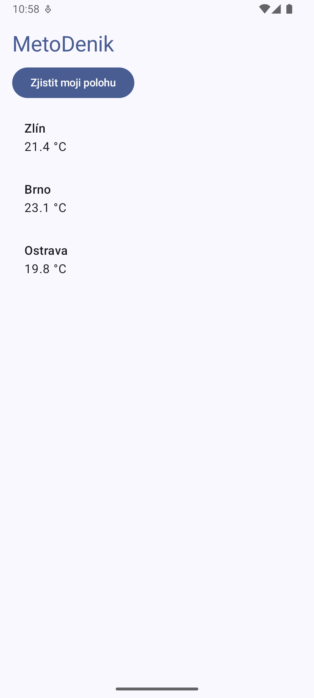
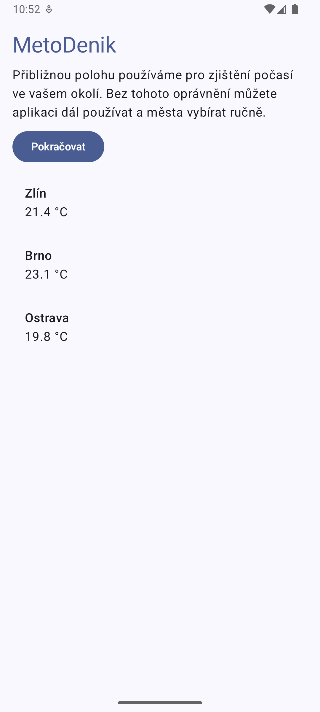
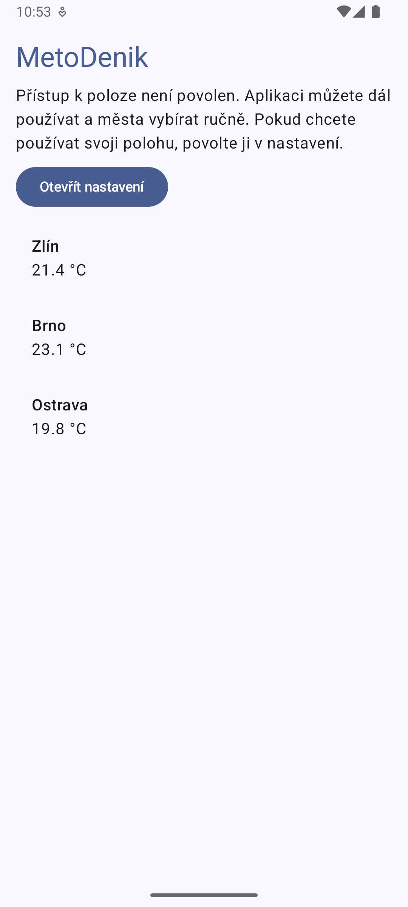
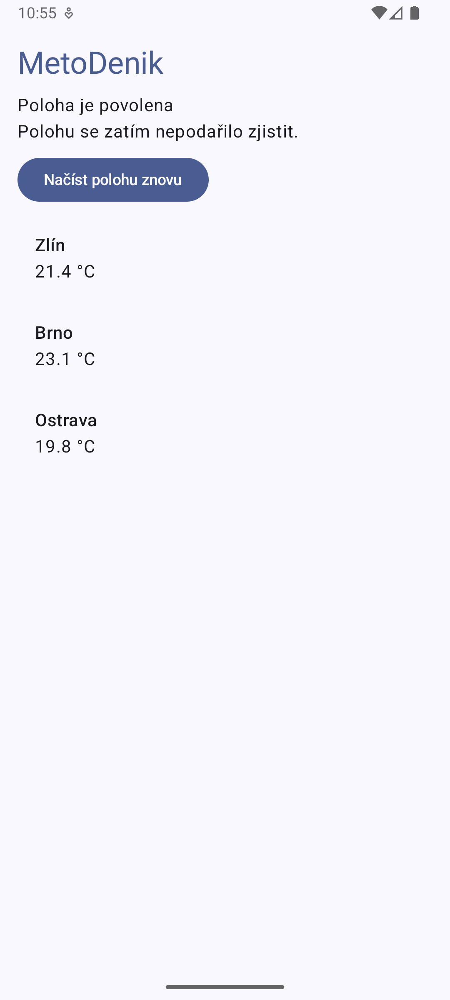

# Lekce 06 – Oprávnění k poloze

## Popis úkolu

V tomto cvičení jsem přidal do aplikace MeteoDeník
možnost požádat uživatele o přístup k přibližné poloze.

Aplikace musí správně reagovat na povolení i zamítnutí
oprávnění a fungovat dál, i když uživatel polohu nepovolí.

## Stavy oprávnění

| Stav | Popis |
|---|---|
| NEZNAMY | Aplikace zatím nemá zaznamenaný výsledek žádosti. Zobrazí tlačítko pro povolení polohy. |
| ODMITNUTO | Uživatel oprávnění zamítl. Před další žádostí se zobrazí vysvětlení. |
| ODMITNUTO_NATRVALO | Po opakovaném zamítnutí aplikace nabídne otevření systémového nastavení. |
| UDELENO | Oprávnění je povoleno a aplikace se pokusí načíst souřadnice. |

## Použitá oprávnění

Pro získání polohy jsem použil oprávnění
ACCESS_COARSE_LOCATION místo ACCESS_FINE_LOCATION.

ACCESS_COARSE_LOCATION umožňuje získat přibližnou polohu,
jejíž přesnost se běžně pohybuje v řádu kilometrů.

ACCESS_FINE_LOCATION umožňuje získat přesnější polohu,
za vhodných podmínek i v řádu desítek metrů.

Pro aplikaci MeteoDeník nám stačí přibližná poloha,
protože potřebujeme zjistit pouze město nebo okolní oblast.
Není tedy nutné vyžadovat přesnou polohu uživatele.

Pro získání souřadnic jsem použil LocationManager
a metodu getLastKnownLocation().

Při testování na emulátoru byla poloha povolena,
ale NETWORK_PROVIDER vracel null.
Aplikace proto zobrazila informaci, že polohu
se zatím nepodařilo zjistit.

## Testování aplikace

Aplikaci jsem testoval na emulátoru Android API 36.

Ověřil jsem všechny čtyři stavy oprávnění.
Po prvním zamítnutí se zobrazilo vysvětlení,
po druhém zamítnutí možnost otevřít nastavení.

Po ručním povolení v nastavení aplikace správně
rozpoznala změnu oprávnění.

### První žádost o polohu

### Vysvětlení po zamítnutí

### Opakované zamítnutí

### Povolená poloha

## Závěr

V tomto cvičení jsem si vyzkoušel práci
s oprávněními v Androidu a jejich kontrolu za běhu.

Aplikace reaguje na povolení i zamítnutí polohy
a funguje dál i bez uděleného oprávnění.